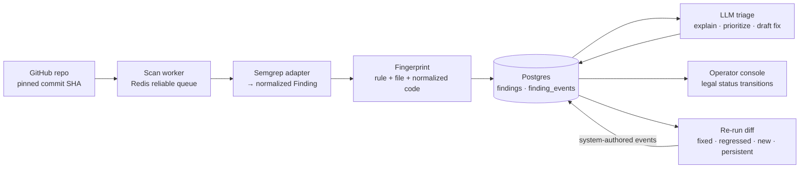

# Vuln Triage & Remediation Console

**Turns noisy static-analysis output into a deduplicated, LLM-explained triage queue — and proves a fix landed by diffing re-scans on stable finding fingerprints.**

Scanners emit thousands of raw, repetitive findings; a security engineer can act on a short, prioritized, explained list. This project is the layer in between: it scans a repository pinned to an exact commit, normalizes findings into one shape, has an LLM explain and prioritize each one using only the finding's own evidence, tracks remediation through an append-only audit trail, and marks a finding `fixed` only when a fresh scan shows it's gone.

Backend: Python, FastAPI, PostgreSQL, Redis. Console: React + TypeScript.



## What makes it work

- **Fingerprints that survive cosmetic change.** A finding's identity is `sha256(rule_id, file_path, normalized snippet)`, with whitespace collapsed and string/number literals replaced. Line numbers are deliberately excluded, so adding an import above a finding doesn't make it look "new", but an actual code fix changes the fingerprint.
- **"Fixed" is earned, never asserted.** The status state machine has no human transition into `fixed`. That status is written only by the re-run diff, with the scan itself recorded as the actor — "fingerprint absent in re-run". Previously-fixed fingerprints that reappear are flagged as `regressed`.
- **Append-only audit trail.** Every status change is an immutable `finding_events` row (who, from, to, when, why). The current status is derived from the latest event, so two operators racing on a stale cached value get a `409 illegal_transition`.
- **LLM triage that fails closed.** The system prompt restricts the model to the provided evidence and requires strict JSON (`explanation`, `priority` p0–p3 or `needs_human`, `exploitability`, `remediation`, `reasoning`). Low temperature, JSON mode, and schema validation; any off-contract or unparseable response becomes `needs_human` instead of a guess.
- **Scans never block the API.** `POST /scans` inserts the row, enqueues the job, and returns `202`. The worker uses Redis `BRPOPLPUSH` into a processing list so an in-flight job survives a crash, and skips scans already `done`/`failed` because delivery is at-least-once.
- **Reproducible scans.** Repos are downloaded as a GitHub zipball at a specific SHA, so every re-run sees byte-identical input.

## API

| Method | Path | Description |
|---|---|---|
| `POST` | `/scans` | Queue a scan: `{repo_id, scanner?, prior_scan_id?}` → `202` |
| `GET` | `/findings/{id}` | Finding detail with evidence, triage output, derived status, and event history |
| `POST` | `/findings/{id}/status` | Request a status transition `{to_status, actor, reason}`; illegal moves return `409` |
| `GET` | `/scans/{id}/diff` | Diff against `prior_scan_id`; records proven `fixed`/`regressed` events |
| `GET` | `/metrics/summary?repo_id=` | Open findings by severity and mean time to remediate |

## Running the pieces

The fingerprint logic has an offline self-check:

```bash
git clone https://github.com/AliAzamat/vuln-triage-remediation-console.git
cd vuln-triage-remediation-console/backend
python -m app.scanning.adapters.semgrep_adapter --self-test
# ok <fingerprint>
```

That module imports the findings repository, which opens a Postgres connection pool at import time, so `psycopg[binary]` and `psycopg_pool` must be installed even for the self-test.

The schema in `backend/app/models/schema.sql` applies cleanly to PostgreSQL 16. The full service additionally needs `fastapi`, `redis`, `httpx`, `openai`, `opentelemetry-api`, the `semgrep` CLI on `PATH`, and these environment variables:

| Variable | Used by |
|---|---|
| `DATABASE_URL` | Postgres connection |
| `REDIS_URL` | Scan queue (defaults to `redis://localhost:6379/0`) |
| `GITHUB_TOKEN` | Downloading repository zipballs |
| `OPENAI_API_KEY` | Triage model calls |

## Layout

```
backend/app/
├── api/            scans.py · findings.py · metrics.py
├── rerun/          diff.py (set math on fingerprints) · api.py
├── scanning/       adapter.py (protocol) · fingerprint.py · adapters/semgrep_adapter.py
├── triage/         prompts.py · llm.py (validation, fail-closed) · stage.py
├── workflow/       transitions.py (legal status moves)
├── repositories/   findings.py · events.py
├── ingest/         github_client.py (pinned-SHA download)
├── queue/          redis_queue.py (reliable queue)
├── obs/            tracing.py (OpenTelemetry spans + counters)
├── models/         schema.sql
└── worker.py       claim → download → scan → persist
frontend/src/
├── lib/api.ts      typed client
└── pages/          FindingDetail.tsx · RerunProof.tsx
```
